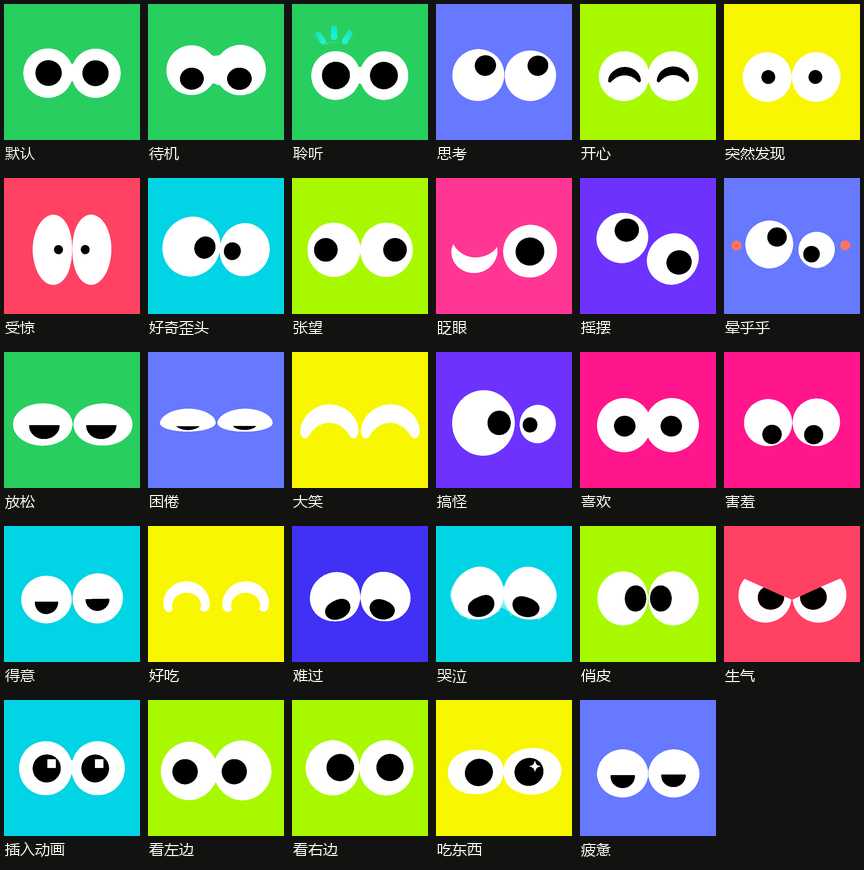
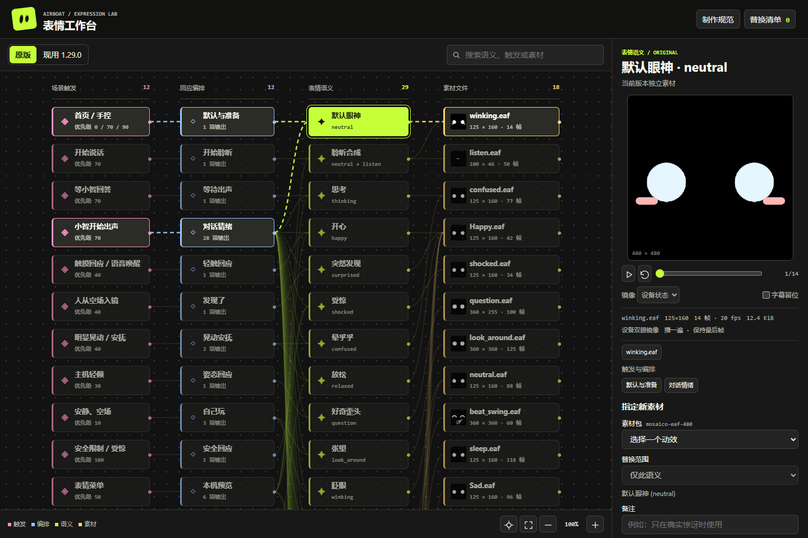

# AirBoat Face Expression

Colorful animated eyes for a playful floating companion. Explore expressive timing, compare animation styles, and map every response on an interactive canvas.

**English** · [简体中文](README.zh-CN.md)

## Explore

- [Animated gallery](output/imagegen/airboat-expression-study-20261120/gallery.html): original animation, reference art, and new GIFs side by side.
- [Expression workbench](docs/product/expression-workbench.html): pan, zoom, play, mirror, trace triggers, and export replacement drafts.
- [Motion keyframes](output/imagegen/airboat-expression-study-20261120/motion-frames.png): anticipation, gaze shifts, rebounds, and settling.
- [Asset manifest](output/imagegen/airboat-expression-study-20261120/manifest.json): models, inputs, prompts, and generation records.

<table>
<tr><td align="center"> Happy · rebound</td><td align="center"> Dizzy · settling</td><td align="center"> Curious · gaze first</td></tr>
</table>

## The collection

| Collection | Contents |
| --- | --- |
| New expression studies | 29 reference images and 29 native animated GIFs, covering 28 firmware semantics plus listening |
| Refined motion previews | 29 looping GIFs sampled at 25 fps, with fixed backgrounds and separate eye/pupil interpolation |
| Original library | 18 EAF assets and their decoded previews |
| Current firmware trials | Three EAF animations used in the AirBoat 1.29.0 baseline |
| Original artwork pack | Nine 480 × 480 source GIFs, EAF files, and conversion metadata |

The visual language pairs large white eyes and black pupils with vivid color fields. Motion uses deliberate pauses, fast eye movements, squash and stretch, smaller secondary rebounds, and pupils that lead or trail the eye shapes.

## Use the workbench

Clone or download the repository, then open **docs/product/expression-workbench.html** in a browser. It runs offline.

1. Drag empty canvas space to pan; use the wheel or view controls to zoom.
2. Select a semantic node to trace its trigger, response, and animation.
3. Play, pause, scrub frames, or compare mirror modes. The default matches the device layout.
4. Switch between the original catalog and the current 1.29.0 trial mappings.
5. Choose candidate artwork, select one semantic or a shared group, and export the replacement JSON.

## Files and tools

| Path | Purpose |
| --- | --- |
| [docs/product/](docs/product/) | Offline canvas, EAF decoder, and bundled animation data |
| [output/imagegen/airboat-expression-study-20261120/](output/imagegen/airboat-expression-study-20261120/) | Reference PNGs, native GIFs, refined previews, prompts, and API records |
| [assets/native/](assets/native/) | Original and trial EAF catalogs |
| [mosaico-eaf-480/](mosaico-eaf-480/) | Original nine-expression artwork pack |
| [scripts/](scripts/) | Catalog generation, image generation, motion processing, and review |
| [docs/production.en.md](docs/production.en.md) | Format, timing, integration, and reusable workflow |

Rebuild and verify the offline catalog with Python:

~~~sh
python scripts/build-expression-workbench.py
python scripts/build-expression-workbench.py --check
~~~

For image and motion tooling:

~~~sh
python -m pip install -r requirements.txt
python scripts/review-expression-imagegen.py
~~~

## Models and production

Static artwork uses **gpt-image-2.5-sunburst** through the official ImageGen CLI. Native GIFs use **gpt-image-2.6-sunburst** through the official Images API. Each API GIF contains 16 frames at 480 × 480. Refined previews retain the generated motion and use local palette cleanup, eye/pupil interpolation, and loop closure.

The generation script accepts a local credential file, proxy URL, and ImageGen CLI path. See the [production workflow](docs/production.en.md). The catalog records the AirBoat 1.29.0 mapping and partition budget; the next production step is selecting artwork, converting it to EAF, and reviewing the result on Mosaico.

## Source and license

[MIT License](LICENSE). Original EAF assets retain their [upstream MIT notice](assets/native/LICENSE.assets), source revision, and hashes. The workbench and asset study were developed for [ESP Airship based on Mosaico](https://github.com/404-NOT-FOUND-ERROR/ESP-Airship-based-on-Mosaico).
