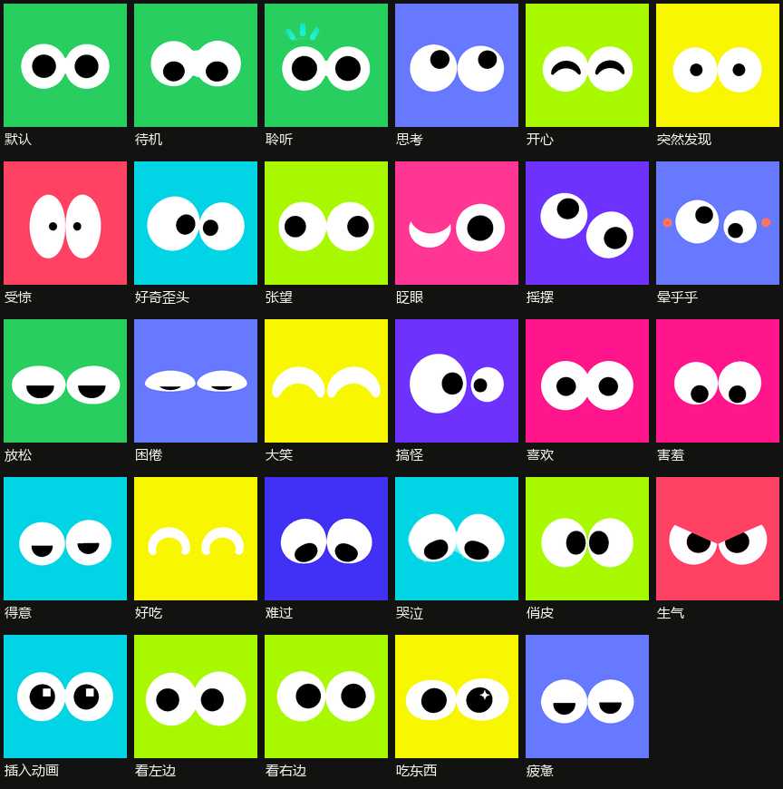

# AirBoat 表情库

为奇幻飞天伙伴设计的多彩眼神与动效。查看动作节拍、对照新旧素材，在无限画布上整理每一种回应。

[English](README.md) · **简体中文**

## 开始浏览

- [表情动效库](output/imagegen/airboat-expression-study-20261120/gallery.html)：原版动画、参考图与新 GIF 并排看。
- [表情工作台](docs/product/expression-workbench.html)：平移、缩放、播放、镜像、追踪触发链路并导出替换清单。
- [完整动画对比](docs/product/expression-workbench.html?compare=happy)：原版与新交付 EAF 并排播放，标出进入、完整表演和收尾，支持暂停与拖帧。
- [480 高清对比](docs/product/expression-workbench.html?quality=happy)：原尺寸轮廓、双眼独立时序与分层过渡；[格式与占用结果](docs/product/layered-expressions.zh-CN.md)。
- [微动作全库](docs/product/expression-contour-review.html)：29 个语义共用绿色待机；可半速对比动作，按节拍跳转。[本地接入卡](docs/product/expression-micro-motion.zh-CN.md)。
- [表情过渡实验室](docs/product/expression-transition-studio.html)：预演共同绿色起始帧、情绪进入、循环表演和自然回归。
- [聆听条融合预览](docs/product/listen-overlay-preview.html)：对比旧黑底与透明波形，并预览 360 / 480 屏幕。
- [动作关键帧](output/imagegen/airboat-expression-study-20261120/motion-frames.png)：查看预动、视线、回弹与回稳。
- [素材清单](output/imagegen/airboat-expression-study-20261120/manifest.json)：查看模型、输入、提示词与生成记录。

旧聆听素材是 100×46 的灰度动画，黑色背景原本也会被绘制。新的[透明聆听条预览](docs/product/listen-overlay-preview.html)与[本地接入说明](integrations/listen-overlay/README.zh-CN.md)展示了在 RGB565 合成阶段去掉黑底、保留波形的做法。

<table>
<tr><td align="center"> 开心 · 回弹</td><td align="center"> 晕乎乎 · 余震</td><td align="center"> 张望 · 瞳孔先动</td></tr>
</table>

## 当前内容

| 内容 | 数量与用途 |
| --- | --- |
| 新表情研究 | 29 张参考图、29 个原生 GIF，覆盖 28 个固件语义与聆听合成 |
| 动效修整版 | 29 个按 25 fps 采样的循环 GIF，统一背景，分别处理眼白和瞳孔 |
| 过渡交付 | 29 份评审 EAF；固件适配使用 28 个 EAF 文件映射 29 个语义，待机与中性共用 |
| 高清分层候选 | 480×480、29 语义，背景／过渡按图层绘制，精确匹配的镜像精灵可共用；含目录 1.99 MiB |
| 原版表情库 | 18 份 EAF 资源及解码预览 |
| 当前固件小样 | AirBoat 1.29.0 使用的三份试换 EAF |
| 原画素材包 | 九份 480×480 GIF、EAF 和转换记录 |

美术语言是大眼白、黑瞳孔与鲜明的色块。动作强调先停一下再动、挤压拉伸、小幅回弹、逐渐衰减的余震，以及瞳孔与眼形错开启动和停止。

## 使用工作台

克隆或下载仓库，用浏览器打开 **docs/product/expression-workbench.html** 即可离线使用。

1. 拖动画布空白处平移，用滚轮或视图按钮缩放。
2. 点一个语义节点，查看它从哪里触发、经过什么编排、使用哪份动画。
3. 播放、暂停、拖动进度条并切换镜像；默认按设备实际布局显示。
4. 在原版、早期小样、240 完整 EAF 和 480 高清候选之间切换。
5. 选新素材，指定单个语义或共用组，最后导出 JSON 替换清单。

## 文件与工具

| 路径 | 内容 |
| --- | --- |
| [docs/product/](docs/product/) | 离线画布、EAF 解码器与内嵌动画数据 |
| [output/imagegen/airboat-expression-study-20261120/](output/imagegen/airboat-expression-study-20261120/) | 参考图、原生 GIF、修整版、提示词与调用参数 |
| [assets/native/](assets/native/) | 原版与试换 EAF 目录 |
| [assets/optimized/](assets/optimized/) | 高清分层候选、来源与哈希目录 |
| [mosaico-eaf-480/](mosaico-eaf-480/) | 九种原画素材包 |
| [scripts/](scripts/) | 目录生成、生图、动作处理与评审脚本 |
| [docs/production.zh-CN.md](docs/production.zh-CN.md) | 制作规格、节拍、接入流程与复用方法 |

使用 Python 重建并检查离线目录：

~~~sh
python scripts/build-expression-workbench.py
python scripts/build-expression-workbench.py --check
~~~

安装图像处理依赖并核对素材：

~~~sh
python -m pip install -r requirements.txt
python scripts/review-expression-imagegen.py
~~~

## 模型与制作流程

静态图通过官方 ImageGen CLI 使用 **gpt-image-2.5-sunburst**；原生 GIF 通过官方 Images API 使用 **gpt-image-2.6-sunburst**。每项原生动画为 480×480、16 帧。修整版保留生成的动作，统一背景、分别插值眼白与瞳孔，并处理循环接缝。

生图脚本通过参数接收本地凭据文件、代理地址和 ImageGen CLI 路径，详见[制作流程](docs/production.zh-CN.md)。原工作台保留 AirBoat 1.29.0 的映射及当时实测的分区预算；表情过渡单独记录接入候选与验证结果。

## 表情衔接

转场采用统一绿色待机基准、独立情绪进入/回归片段和可循环表演段。详细规范与本地预演见[表情过渡说明](docs/product/transition-spec.zh-CN.md)。

连续回应顺着当前眼神转向下一个情绪。可查看[聆听 → 思考 → 开心](output/imagegen/airboat-expression-study-20261120/transitions/demos/listen-think-happy.gif)和[开心 → 惊喜](output/imagegen/airboat-expression-study-20261120/transitions/demos/happy-surprised.gif)。29 份评审 EAF 附进入／循环／退出帧范围。

AirBoat **1.32.0 接入候选**已准备在配套固件工作目录。电脑检查覆盖 841 组语义切换、途中改选、取消、时钟回绕、原播放器，以及评审 EAF 的全部 1,365 帧；桌面和手机浏览器检查、固定 SDK 的 S31 候选构建均通过。主应用为 11,951,904 B，应用分区余 1,614,048 B；离线更新包与构建镜像哈希一致。后续由主开发合入当前工作分支，再做原生界面、S31 内存与帧耗时、相机/语音共存和实机验收。详见[固件交接说明](docs/device-integration.zh-CN.md)。

## 来源与许可

[MIT 许可证](LICENSE)。原 EAF 素材保留[上游 MIT 说明](assets/native/LICENSE.assets)、源版本与文件校验值。工作台和表情研究来自 [ESP Airship based on Mosaico](https://github.com/404-NOT-FOUND-ERROR/ESP-Airship-based-on-Mosaico) 项目。
