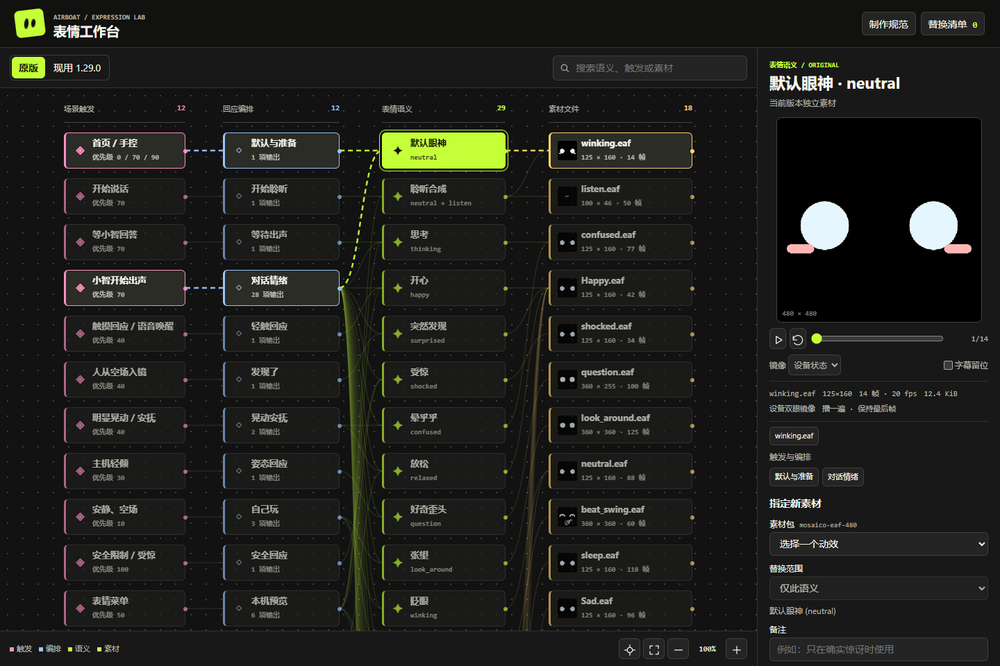

# AirBoat 表情库

为奇幻飞天伙伴设计的多彩眼神与动效。查看动作节拍、对照新旧素材，在无限画布上整理每一种回应。

[English](README.md) · **简体中文**

## 开始浏览

- [表情动效库](output/imagegen/airboat-expression-study-20261120/gallery.html)：原版动画、参考图与新 GIF 并排看。
- [表情工作台](docs/product/expression-workbench.html)：平移、缩放、播放、镜像、追踪触发链路并导出替换清单。
- [动作关键帧](output/imagegen/airboat-expression-study-20261120/motion-frames.png)：查看预动、视线、回弹与回稳。
- [素材清单](output/imagegen/airboat-expression-study-20261120/manifest.json)：查看模型、输入、提示词与生成记录。

<table>
<tr><td align="center"> 开心 · 回弹</td><td align="center"> 晕乎乎 · 余震</td><td align="center"> 张望 · 瞳孔先动</td></tr>
</table>

## 当前内容

| 内容 | 数量与用途 |
| --- | --- |
| 新表情研究 | 29 张参考图、29 个原生 GIF，覆盖 28 个固件语义与聆听合成 |
| 动效修整版 | 29 个按 25 fps 采样的循环 GIF，统一背景，分别处理眼白和瞳孔 |
| 原版表情库 | 18 份 EAF 资源及解码预览 |
| 当前固件小样 | AirBoat 1.29.0 使用的三份试换 EAF |
| 原画素材包 | 九份 480×480 GIF、EAF 和转换记录 |

美术语言是大眼白、黑瞳孔与鲜明的色块。动作强调先停一下再动、挤压拉伸、小幅回弹、逐渐衰减的余震，以及瞳孔与眼形错开启动和停止。

## 使用工作台

克隆或下载仓库，用浏览器打开 **docs/product/expression-workbench.html** 即可离线使用。

1. 拖动画布空白处平移，用滚轮或视图按钮缩放。
2. 点一个语义节点，查看它从哪里触发、经过什么编排、使用哪份动画。
3. 播放、暂停、拖动进度条并切换镜像；默认按设备实际布局显示。
4. 在「原版」与「现用 1.29.0」之间切换，比较素材与共用关系。
5. 选新素材，指定单个语义或共用组，最后导出 JSON 替换清单。

## 文件与工具

| 路径 | 内容 |
| --- | --- |
| [docs/product/](docs/product/) | 离线画布、EAF 解码器与内嵌动画数据 |
| [output/imagegen/airboat-expression-study-20261120/](output/imagegen/airboat-expression-study-20261120/) | 参考图、原生 GIF、修整版、提示词与调用参数 |
| [assets/native/](assets/native/) | 原版与试换 EAF 目录 |
| [mosaico-eaf-480/](mosaico-eaf-480/) | 九种原画素材包 |
| [scripts/](scripts/) | 目录生成、生图、动作处理与评审脚本 |
| [docs/production.zh-CN.md](docs/production.zh-CN.md) | 制作规格、节拍、接入流程与复用方法 |

使用 Python 重建并检查离线目录：

~~~sh
python scripts/build-expression-workbench.py
python scripts/build-expression-workbench.py --check
~~~

安装图像处理依赖并核对素材：

~~~sh
python -m pip install -r requirements.txt
python scripts/review-expression-imagegen.py
~~~

## 模型与制作流程

静态图通过官方 ImageGen CLI 使用 **gpt-image-2.5-sunburst**；原生 GIF 通过官方 Images API 使用 **gpt-image-2.6-sunburst**。每项原生动画为 480×480、16 帧。修整版保留生成的动作，统一背景、分别插值眼白与瞳孔，并处理循环接缝。

生图脚本通过参数接收本地凭据文件、代理地址和 ImageGen CLI 路径，详见[制作流程](docs/production.zh-CN.md)。工作台保留 AirBoat 1.29.0 的映射与分区预算。后续按评审结果选稿，转成 EAF，再在 Mosaico 实屏确认节拍和构图。

## 来源与许可

[MIT 许可证](LICENSE)。原 EAF 素材保留[上游 MIT 说明](assets/native/LICENSE.assets)、源版本与文件校验值。工作台和表情研究来自 [ESP Airship based on Mosaico](https://github.com/404-NOT-FOUND-ERROR/ESP-Airship-based-on-Mosaico) 项目。
